# h0 Oikeasti netissä

**Palvelinten hallinta – ICI001AS3A-3015**
**Ville Nietula**
*Tehty 28.10.2026*

Asensin Debian 13:n paikallisesti Hyper-V-virtuaalikoneeseen, vuokrasin virtuaalipalvelimen UpCloudista ja pystytin sille weppipalvelimen sekä domain-nimen.

## Lähtökohdat

Harjoituksen tein läppärillä, jossa on AMD Ryzen 5 4500U -suoritin ja 32 Gt RAM-muistia. Isäntäkäyttöjärjestelmänä Windows 11 ja virtualisointina Hyper-V, jota en ollut ennen kokeillut VirtualBoxin sijaan. Netin kautta asennukset menivät normaalia kotireittiä pitkin.

## x) Lue ja tiivistä

*Kuhunkin lähdeviitteeseen 3–5 ranskalaista viivaa olennaisesta sisällöstä + oma kysymys tai huomio. Ei esseemuotoa.*

### Niemi 2025: H4 Tehtävät

- Dokumentoitu koko h4-prosessi: VPS:n vuokraus (UpCloud, 3 €/kk, Debian 13 trixie), sijainnin valinta (Suomi/Eurooppa viiveen ja GDPR:n takia), SSH-avainten luonti (`ssh-keygen`) ja liittäminen palveluntarjoajaan
- Alkutoimet: `adduser` + sudo-oikeudet, `.ssh`-kansion ja `authorized_keys`-tiedoston oikeudet (`chmod 700/600`, `chown`), tulimuuriin reikä ssh:lle ennen aktivointia (`ufw allow 22/tcp`, `ufw enable`), root-tilin lukitus (`usermod --lock root`, `PermitRootLogin no`)
- Weppipalvelin: `apt install apache2`, etusivun korvaus (`/var/www/html/index.html`, `echo "..." | sudo tee ...`), portin 80 avaus palomuuriin
- **Oma huomio:** Niemen dokumentaatio on laaja ja hyvä, ja se toimii hyvänä pohjana ja tarkistuslistana tämän h0-tehtävän suorittamiseen, sillä vaiheet vastaavat lähes 1:1 tehtävän kohtia b–d

### Partanen 2025: Harjoitus 5: Nimekäs a) Nimi

- Halvimman tarjoajan haku: Namecheap, domain *aleksipartanen.space* 0,83 €/vuosi + ilmainen domain privacy; hylättiin tarjolla olleet lisäpalvelut
- DNS:n määritys Namecheapin Domain List → Advanced DNS -näkymässä: turha CNAME poistetaan, lisätään A-tietue (`@` = paljas domain, `www` = www-alidomain), TTL 5 min jotta muutokset näkyvät nopeasti
- Alidomainit (`yksi.`, `kaksi.`) omilla A-tietueillaan; DNS-tietojen tutkiminen `dig`-komennolla (`dig @8.8.8.8 domain -t ANY`, tietuetyypit AAAA, A, TXT, NS, CAA, SOA)
- **Oma huomio:** Namecheap on minulle entuudestaan tuttu. Yleensä ohitan Namecheapin sisäisen DNS-editorin ja vaihdan domainin nimipalvelimet Cloudflaren ilmaisversioon, joka on oman kokemukseni pohjalta sulavampi käyttää. Harjoituksessa kannattaa mainita kumpaa reittiä itse käyttää.

## a) Paikallinen: Debian 13 virtuaalikoneeseen

Isoin osa tästä meni ihan rutiinilla, mutta yksi pieni kommellus matkan varrella opetti enemmän kuin itse onnistunut asennus. Käyn läpi koko asennuksen.

### Kone pystyyn Hyper-V:llä

Avasin Hyper-V Managerin ja aloitin virtuaalikoneen luonnin. Quick Create -lista houkutteli valmiilla Ubuntulla ja Windows-ympäristöillä, mutta tässä harjoituksessa haluan nimenomaan Debian 13:een, joten valitsin paikallisen asennuslähteen (Debianin netinst-ISO, jonka olin ladannut debian.orgista) ja annoin koneelle nimeksi `h0-deb13`:

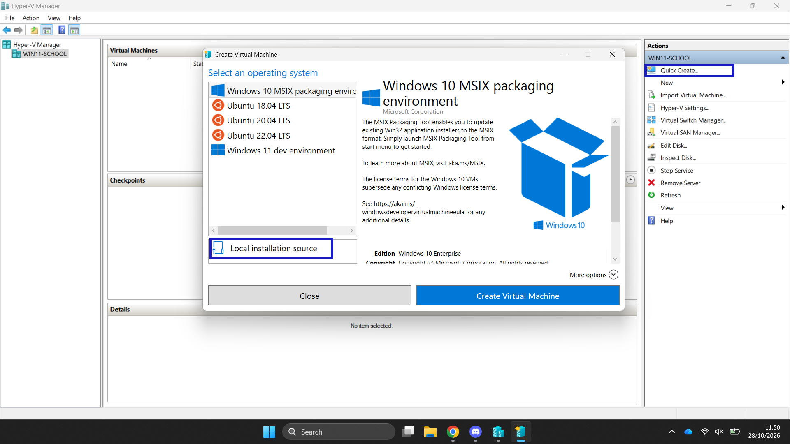

Muutaman next-napin jälkeen kone oli valmis. Asetuksista tarkistin vielä muistin, levyn ja erityisesti verkkoadapterin: oletuksena oleva Default Switch toimii hienosti, kun ISO on kiinni virtuaalisessa DVD-asemassa:

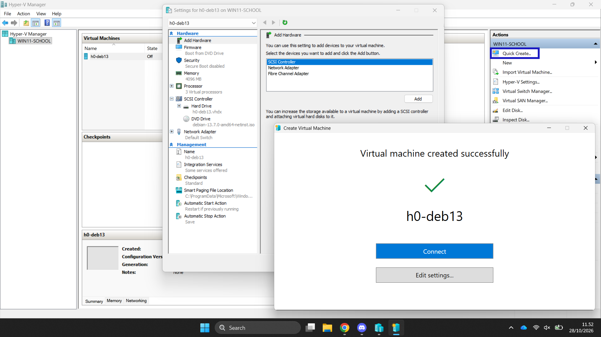

### Debianin graafinen asennus

Käynnistin koneen ja Debianin graafinen asennusohjelma lähti käyntiin. Kielivalinnat ja näppäimistö menivät oletuksilla (suomi/englanti, kumpi nyt kullekin sopii) ja verkon säädössä annoin koneelle lyhyen ja ytimekkään hostname-nimen, saman `h0-deb13` kuin Hyper-V:ssäkin, jotta koneen tunnistaa logeista ja päätteestä yhdellä silmäyksellä:

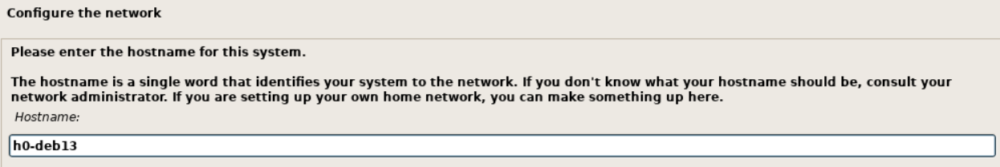

Seuraavaksi root-salasana. Jätin sen tarkoituksella tyhjäksi, koska tuore Debian lukitsee root-tilin ja sallii sudo-oikeudet ensimmäiselle käyttäjälle. Tämä on mielestäni nykyaikaisempi tapa: ei tarvitse muistaa kahta salasanaa, ja normaali työskentely tapahtuu silti omalla käyttäjällä sudoillen:

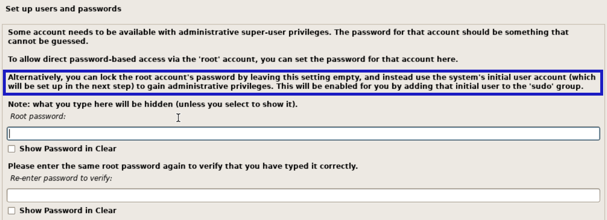

Ensimmäiselle käyttäjälle annoin nimen `ladmin`. Kyllä, se on vähän laiskasti keksitty, mutta toimiva, ja oikeastaihan sähköpostin nimen origon tarkoitus on olla "oikea" nimi:

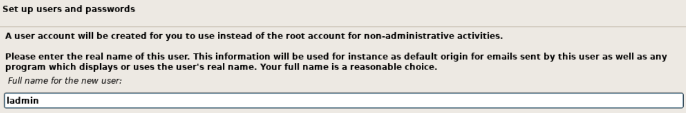

### Partitiointi

Levyä (Hyper-V:n 136 GB virtuaalilevy) en päättänyt pilkkoa mitenkään fiksusti, vaan valitsin ohjatun asennuksen koko levyn käyttöön:


Ja osiointikin meni kaikkein yksinkertaisimmallaan eli kaikki yhteen osioon. Harjoituskoneelle riittää. Jos joskus tarvitsisi erillistä /homea tai palvelinrooleja, voisi harkita tarkemmin, mutta nyt tämä oli selkein ja nopein reitti:

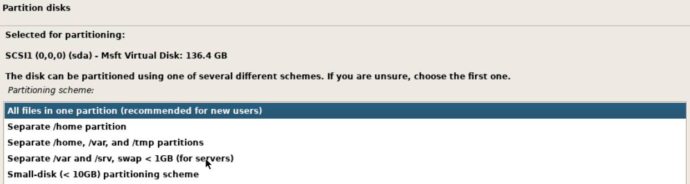

### Työpöytä ja viimeiset vaiheet

Ohjelmavalinnassa ruksasin Debian-työpöydän lisäksi KDE Plasman, koska Plasma on itselleni tutuin, ja standardijärjestelmätyökalut mukaan lukien. SSH-palvelinta en tässä vaiheessa erikseen rastittanut, koska tarkoitus oli asentaa se VPS-puolella (kohta c) käsin:

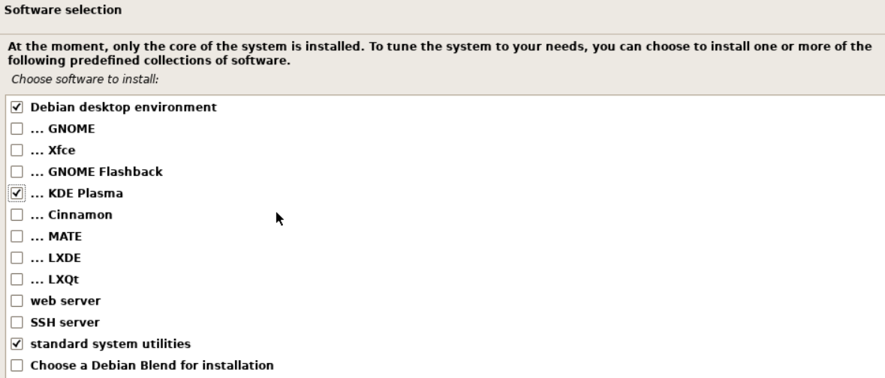

GRUB meni levyn ensimmäiselle osiolle oletusasetuksilla, ja asennus eteni viimeiselle ruudulle, jossa asennin kehottaa irrottamaan asennusmedian ennen uudelleenkäynnistystä.

### Opittua: ISO irti ennen uudelleenkäynnistystä

Tässä kohtaa mokasin ensimmäisellä yrityksellä. Painoin jatka-askeleen läpi niin nopeasti, etten irrottanut ISO-kuvaa, ja kone käynnistyikin uudelleen asennusohjelmaan, ei asennettuun Debianiin. Hetken ihmettelin, että "eihän tämä asentanut mitään", kunnes tajusin tilanteen: levy oli aivan hyvin asennettu, mutta virtuaalinen DVD-asema oli edelleen kiinni ja boottijärjestys kävi sieltä ensin.

Korjaus oli onneksi simppeli: sammutin koneen, Hyper-V:ssä irrotin ISO:n (Settings → DVD Drive → ei mediaa / Media → Eject), ja käynnistin koneen uudelleen. Tällä kertaa kone boottasi suoraan Debianiin ja Plasma-työpöytä aukeni kirjautumisruutuun. Vasta tässä vaiheessa asennus oli oikeasti valmis.

Eli jos yksi juttu tästä asennuksesta jää mieleen, niin se on tämä: **asennus ei ole valmis, ennenkuin ISO on irti ja kone boottaa levyltä**. Hyvä muistaa myös pilvipuolella, jos joskus törmää vastaavaan "bootaa väärältä medialta" -tilanteeseen.

## b) VPS

Palvelinvuokraajaksi valitsin UpCloudin: suomalainen toimija, halpa peruslinja ja läpinäkyvä hinnoittelu, eli ihan tehtävänanninkin suosittelemaa kategoriaa. Isot pilvialustat (AWS, Azure, GCP) jätin tähän tarkoituksella rouhimatta, koska harjoitusta varten en halunnut opetella konsoleita vaan saada palvelin pystyyn.

Koneen luonti oli yllättävän kivutonta. Valitsin sijainniksi FI-HEL2:n (Helsinki), jolloin viive jää pieneksi ja tieto pysyy EU:n sisällä. Käyttöjärjestelmäksi Debian GNU/Linux 13 (Trixie), sama versio kuin paikallisessa virtuaalikoneessa, jotta molemmat ympäristöt toimivat samalla tavalla. Kookin pienin tarjolla oleva: 1 CPU, 1 GB RAM, 10 GB levyä, hinnaksi 3 €/kk. Julkinen IPv4 ja IPv6 päälle, ja kasassa oli ihan riittävä peliväline tälle harjoitukselle:

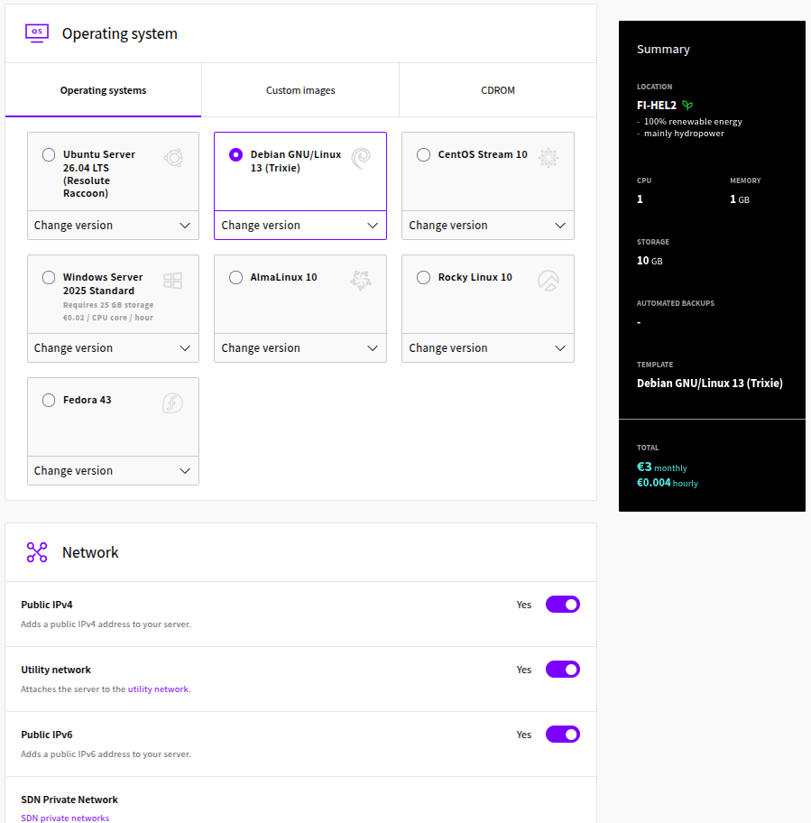

Kirjautumistavaksi valitsin SSH-avaimen, koska salasanalla kirjautumiseen en edes halunnut mahdollisuutta. Avaimen olin luonut valmiiksi paikallisella koneella (`ssh-keygen`, oletuspolkuun `~/.ssh/id_ed25519`) ja lisännyt julkisen osan UpCloudin SSH-avainasetuksiin. Isäntänimen annoin kuvamaista `debian-1cpu-1gb-fi-hel2`, jotta koko configuraatio on luettavissa nimestä. Deploy-nappia painettua palvelin oli pystyssä noin minuutissa:

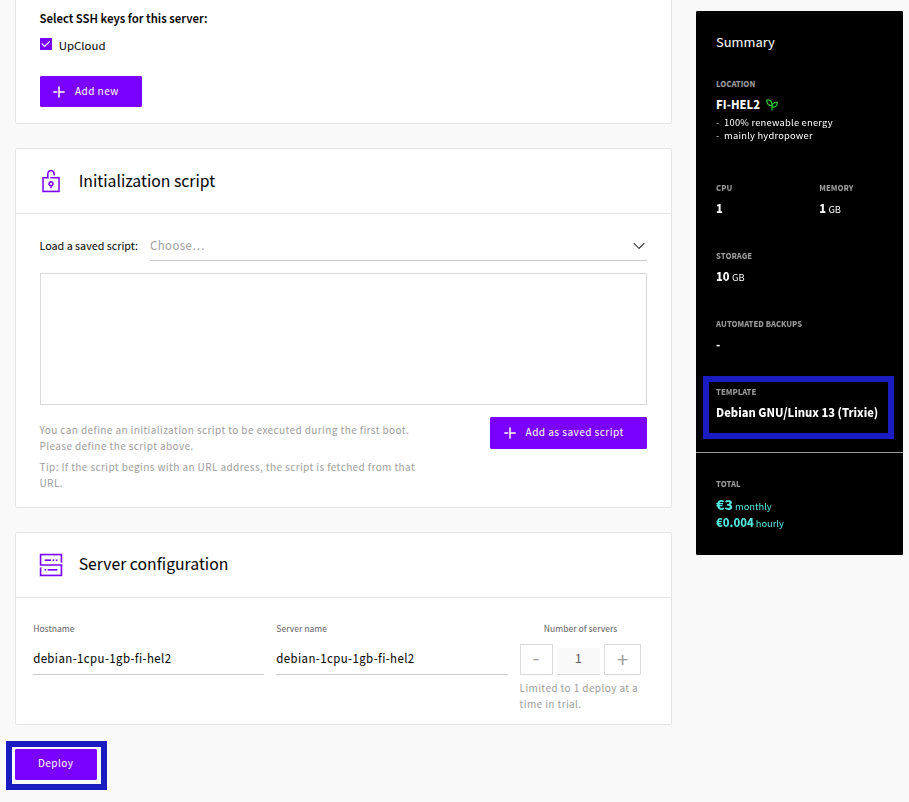

## c) Alkutoimet

Ensimmäinen kirjautuminen, ja samalla ainoa kerta root-käyttäjänä. 1Passwordiin tallennetun yksityisen avaimen latasin paikalliselle koneelle `~/.ssh/id_ed25519`-tiedostoksi (oikeudet tietysti `chmod 600`, ssh ei muuten suostu käyttämään sitä), ja yhteydenotto onnistui heti:

```bash
ssh -i ~/.ssh/id_ed25519 root@94.237.15.231
```

Root-kirjautumista ei ole tarkoitus jatkaa pidempään kuin kirjautumiseen asti, joten seuraavaksi loin oman sudo-käyttäjän ja siirsin sille SSH-avaimen:

```bash
adduser ville
usermod -aG sudo ville
mkdir -p /home/ville/.ssh
cp /root/.ssh/authorized_keys /home/ville/.ssh/
chown -R ville:ville /home/ville/.ssh
chmod 700 /home/ville/.ssh
chmod 600 /home/ville/.ssh/authorized_keys
```

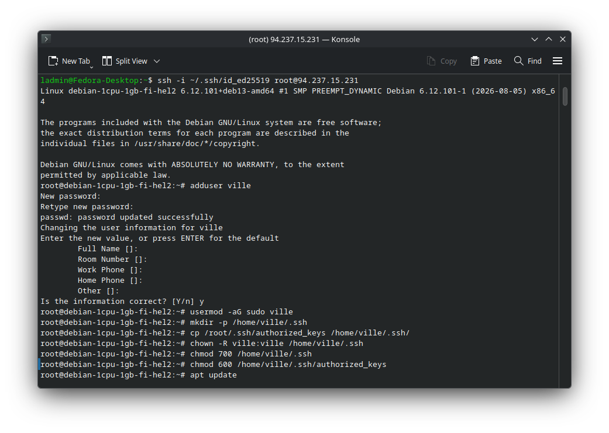

Tulimuuri asentui ja aktivoitui reiällä SSH:lle: tärkeintä on avata portti 22 *ennen* kuin palomuurin kytkee päälle, muuten katkaisee oman istuntonsa:

```bash
apt update
apt install ufw -y
ufw allow 22/tcp
ufw enable
ufw status
```

Root-tilin lukitsin ja estin rootin SSH-kirjautumisen vasta sen jälkeen, kun olin ehtinyt testata uudella käyttäjällä kirjautumisen toimivan:

```bash
sudo usermod --lock root
sudo sed -i 's/^#?PermitRootLogin.*/PermitRootLogin no/' /etc/ssh/sshd_config
sudo systemctl restart ssh
```

Ohjelmien päivitys (`apt update` ja `apt upgrade -y`) ajettiin samalla istunnolla:

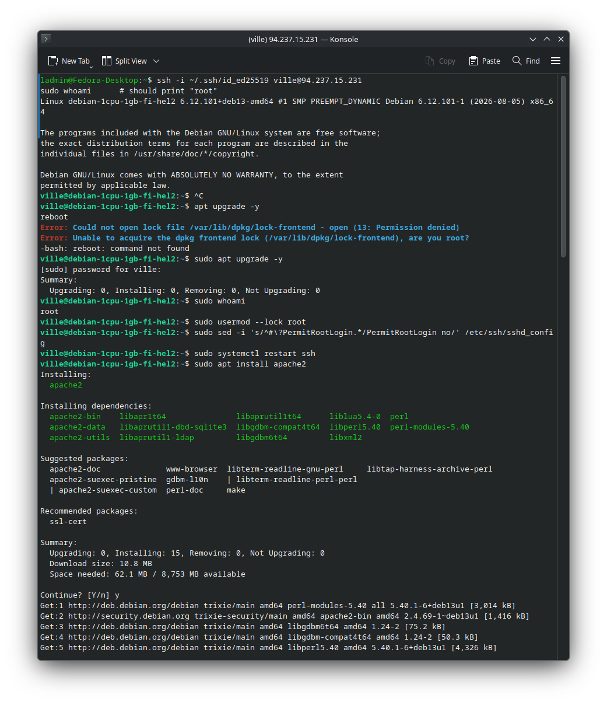

## d) Weppipalvelin

Weppipalvelimeksi Apache, koska se on kurssin perustyökalu ja dokumentaatiota löytyy loputtomasti:

```bash
sudo apt install apache2
sudo ufw allow 80/tcp
```

Ja ihan vain selaimella osoitteeseen http://94.237.15.231: "It works!" vastasi, eli palvelu kulki portissa 80 aivan kuten pitikin:

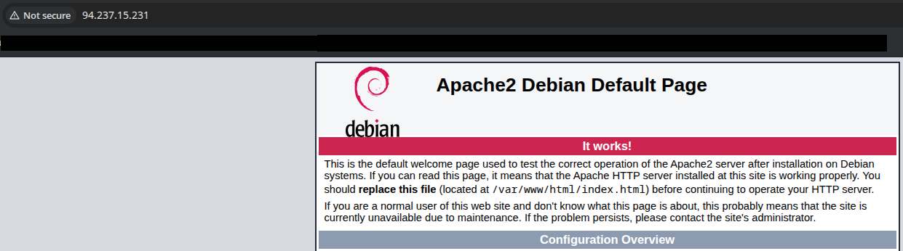

Oletussivun tilalle vaihdoin ihan oman minimaalisen HTML-sivun: tarpeeksi erottuva oletuksesta, mutta riittävän simppeli, ettei siinä ole mitään rikki menevää:

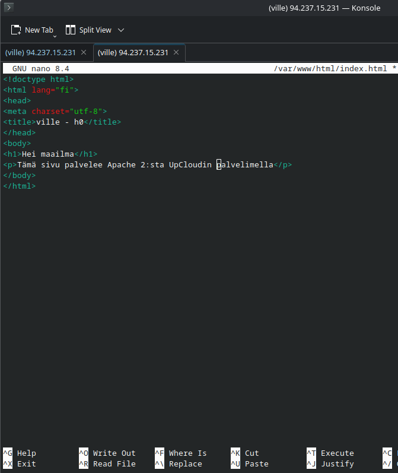

## e) Vapaaehtoinen: Domain-nimi

Nimenä oli .space-päätteinen harjoitusdomain (halvin kategoria, mielellään sellainen jota ei kannata uusia). Namecheapin Advanced DNS -näkymässä poistin ensin oletuksena olleet parkkeeraustietueet, koska Namecheap luo jokaiselle uudelle domainille oletuksena A-tietueet parkkeerauspalvelimelleen (192.64.x.x). Tilalle lisäsin omat A-tietueet: `@` (paljas domain) ja `www`, molemmat osoittamaan palvelimen IPv4-osoitteeseen. TTL:n jätin Automatic-vaihtoehtoon, kun muutokset eivät juuri tällä kertaa vaatineet minuuttia tarkempaa ajoitusta:

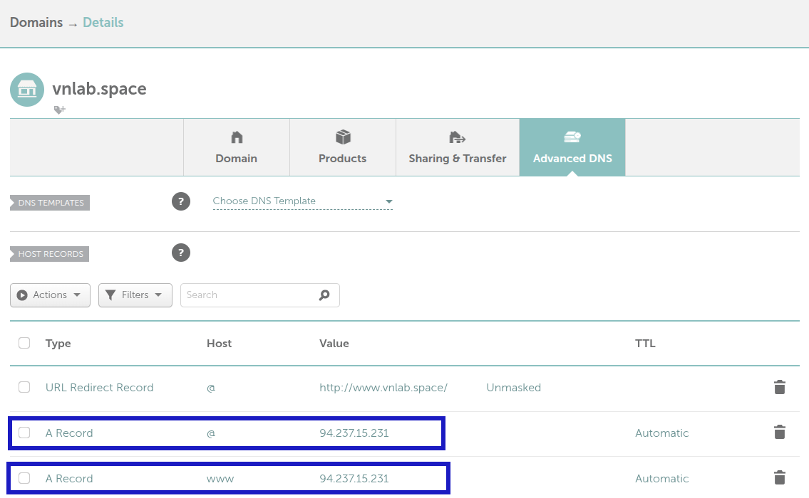

## Lähteet

- Karvinen 2006: Raportin kirjoittaminen. Luettavissa: https://terokarvinen.com/2006/raportin-kirjoittaminen-4/
- Karvinen 2023: Create a Web Page Using Github. Luettavissa: https://terokarvinen.com/2023/create-a-web-page-using-github/
- Karvinen 2017: First Steps on a New Virtual Private Server – an Example on DigitalOcean and Ubuntu 16.04 LTS. Luettavissa: https://terokarvinen.com/2017/first-steps-on-a-new-virtual-private-server-an-example-on-digitalocean/
- Niemi 2025: H4 Tehtävät. Luettavissa: https://github.com/AONCODES/linux-course/blob/main/h4.md
- Partanen 2025: Harjoitus 5: Nimekäs. Luettavissa: https://partanennn.github.io/linux-servers/practices/fifth-week.html

### Maininta tekoälyn käytöstä

Markdown-tiedostojen luomisessa ja editoinnissa käytin apuna Mistral AI:n Vibe-tekoälyä (https://mistral.ai). Kaikki tekemiset, komennot ja valinnat raportissa ovat omia, ja kuvakaappaukset otin itse; tekoäly toimi dokumentoinnin apuvälineenä.
