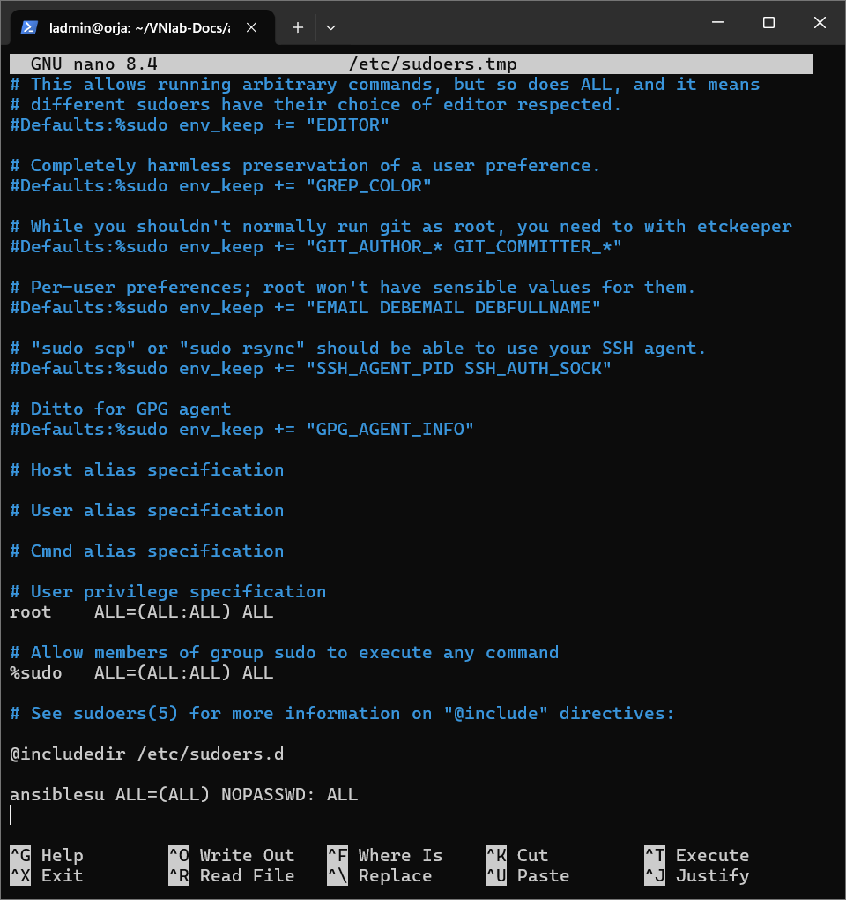
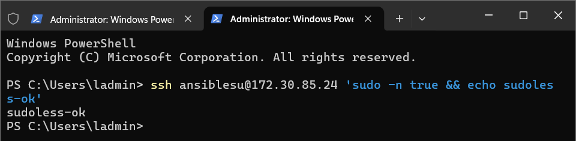
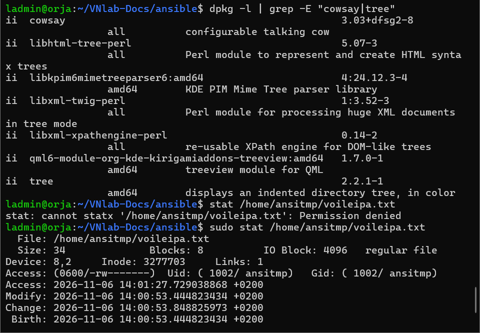
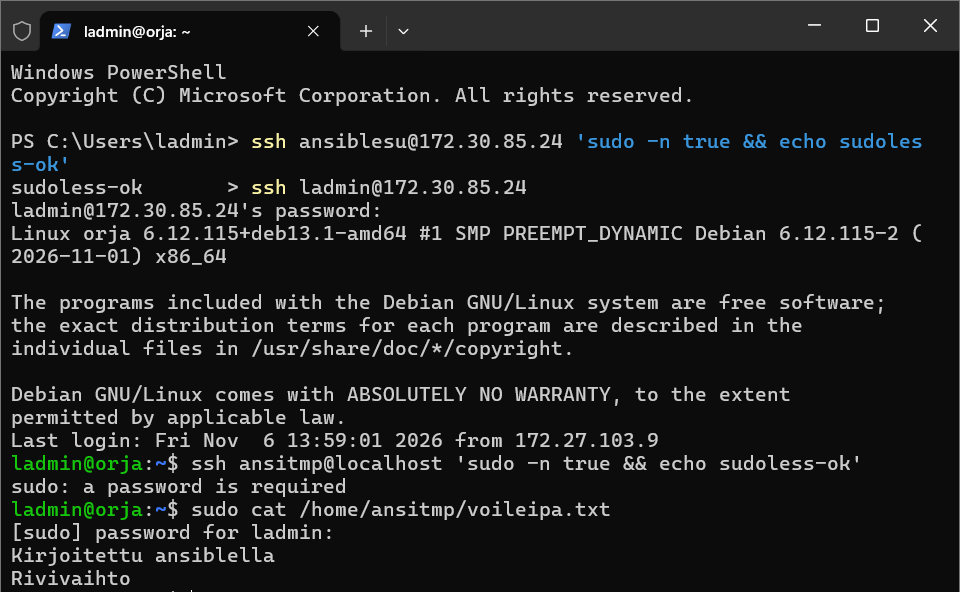

# h2 Hups... Ongelmia? Ongelmanratkaisu ja Drift Management

*Ville Nietula, Haaga-Helian tunnus configurations management - kurssin kotitehtävä h2. Työ tehty 6.11.2026 Debian 13 (orja) -koneella.*

## Tiivistelmä (x)

### Karvinen 2026: SSH public key - Login without password

- Käy läpi ssh-paketin käytön: kirjautumisen ssh:llä, avainparin luonnin (`ssh-keygen`) ja julkisen avaimen siirtämisen palvelimelle (`ssh-copy-id`), minkä jälkeen kirjautuminen onnistuu ilman salasanaa
- Keskeinen periaate: julkinen avain menee orjan `~/.ssh/authorized_keys`-tiedostoon, yksityinen avain pysyy koneella
- **Oma huomio:** sama ketju (keygen → copy-id → salasanaton kirjautuminen) toimi h2:n a)-kohdassa sellaisenaan

### Karvinen 2026: Hello Ansible

- Käy Ansiblen käytön läpi selkeästi: asennuksen, inventaarion, playbooken ajon ja yksinkertaisten tehtävien automatisoinnin
- Purkaa myös Ansiblen kansiorakenteen ja roolit, eli miten isompi projekti kannattaa järjestää
- **Oma huomio:** roolien ja kansiorakenteen kuvaus oli hyötyä, kun järjestin oman projektini rakenteen

### Karvinen 2026: Sudo without password

- Salasanaton sudo määritellään lisäämällä käyttäjälle oma sääntö: `ansiblesu ALL=(ALL) NOPASSWD: ALL`
- Siistimpi tapa on laittaa sääntö omaan tiedostoonsa hakemistoon `/etc/sudoers.d/` sen sijaan, että muokkaa pää-sudoers-tiedostoa suoraan
- Testaus: `sudo -n true && echo sudoless-ok` tulostaa `sudoless-ok`, jos sudo toimii ilman salasanaa
- **Oma huomio:** itse muokkasin pää-sudoers-tiedostoa visudolla, mutta /etc/sudoers.d/ olisi jatkossa parempi, koska oma sääntö pysyy erillään järjestelmän oletuksista

### Munroe 2006: xkcd 149: Sandwich

- Sarjakuva tiivistää sudon perusajatuksen: oikea "taikasana" (`sudo`) antaa käyttäjälle oikeudet, joita ei muuten olisi
- Vitsi toimii, koska sudo on arjen työkalu, jonka jokainen linux-käyttäjä tunnistaa heti
- **Oma huomio:** `NOPASSWD: ALL` on laboratorioympäristössä ok, mutta tuotannossa oikeudet kannattaisi rajata vain tarvittuihin komentoihin

### Karvinen 2026: Passwordless Sudo with Ansible

- Salasanaton sudo voidaan määrittää myös Ansibella: `lineinfile`-moduulilla lisätään sääntöä vastaava rivi tiedostoon `/etc/sudoers.d/`
- Näin sudon konfiguraatio on osa playbookia: toistettava, dokumentoitu ja idempotentti
- **Oma huomio:** h2:ssa tein sudon säädön manuaalisesti ennen Ansible-vaihetta; seuraavalla kerralla kirjoittaisin sen suoraan playbookeen, jolloin koko ympäristö nousisi tyhjästä yhdellä ajolla

### Ansiblen sisäänrakennettu dokumentaatio (`ansible-doc`)

- Kustakin moduulista näkee johdannon, nimetyt optiot selityksineen ja EXAMPLES-osion; helppo esimerkki riittää yleensä suoraan tehtävään
- `ansible-doc copy`: `content`, `dest`, `src`; `owner`, `group`, `mode`
- `ansible-doc apt`: `name`, `state`, `update_cache`
- `ansible-doc file`: `path`, `recurse`, `src`, `state`; `owner`, `group`, `mode`
- `ansible-doc user`: `name`; `create_home`, `comment`, `groups`, `shell`, `state`, `system`
- `ansible-doc authorized_key`: `user`, `key`
- **Oma huomio:** `ansible-doc` riittää usein koko dokumentaatioksi ilman nettiselailua; h2-playbookin optiot (content/owner/mode ym.) tarkistin juuri näin

## Ympäristö

- Isäntäkone: AMD Ryzen 5 4500U, 32 Gt RAM, Windows 11; virtualisointi Hyper-V (sama menetelmä kuin [h0-raportissa](https://github.com/veenetul/VNlab-Docs/blob/main/h0-oikeasti-netissa-vn.md))
- Orjakone: Debian 13, ip `172.27.103.9`, käyttäjä `ladmin` (kurssikone "orja")
- Ansible: `ansible-playbook --version` - täydennä tuloste
- Projektikansio: `~/VNlab-Docs/ansible` (versiohallinta Git/GitHub)

## a) Sudoless-käyttäjä

Loin käyttäjän `ansiblesu` ja annoin sille salasanattoman sudon, jotta Ansible voi ajaa tehtäviä täysin automaattisesti ilman salasanakyselyä.

```bash
sudo adduser ansiblesu
```

Sitten lisäsin sudoers-tiedostoon salasanan poistavan säännön:

```bash
sudo visudo
# tiedoston loppuun:
ansiblesu ALL=(ALL) NOPASSWD: ALL
```

Kopioin ssh-avaimen ja testasin:

```bash
ssh-copy-id ansiblesu@172.27.103.9
ssh ansiblesu@172.27.103.9 'sudo -n true && echo sudoless-ok'
# → sudoless-ok
```





**Kuvakaappaus:** `Screenshot 2026-11-06 132126.png` (`ssh ansiblesu@172.27.103.9` - kirjautuminen onnistuu)

## b) Uusi SSH-käyttäjä playbookilla

Playbook luo käyttäjän `ansitmp`, lisää sille orjan julkisen ssh-avaimen ja sudo-ryhmän:

```yaml
- name: ssh tunnus
  user:
    name: ansitmp
    shell: /bin/bash
    groups: sudo
    create_home: true

- name: pubkey ansitmp
  authorized_key:
    user: ansitmp
    key: "{{ lookup('file', '/home/ladmin/.ssh/id_ed25519.pub') }}"
```

Testi:

```bash
ssh ansitmp@localhost
```

Kirjautuminen onnistuu ilman salasanaa, koska orjan julkinen avain on `authorized_keys`-tiedostossa.

**Kuvakaappaus:** `h2playbook.png` (koko site.yml nano-editorissa - kaikki tehtävät b-e)

**Kuvakaappaus:** `Screenshot 2026-11-06 141026.png` (ssh-yhteys ansitmp:lle)
<!-- TODO: varmista että kuvasta näkyy, ettei salasanaa kysytä. Jos ei, ota uusi kuva siistillä kirjautumisella -->

## c) Kaksi pakettia

```yaml
- name: pakettiasennus
  apt:
    name: [cowsay, tree]
    state: present
    update_cache: true
```

Molemmat asentuvat:

```bash
dpkg -l | grep -E "cowsay|tree"
```

**Kuvakaappaus:** `h2verif2.png` (dpkg-listauksessa cowsay 3.03+dfsg2-8 ja tree 2.2.1-1)

## d) Tiedosto: monirivinen sisältö + omistaja + oikeudet

```yaml
- name: monirivi filu ja omistaja seka oikeudet
  copy:
    content: |
      Kirjoitettu ansiblella
      Rivinvaihto
    dest: /home/ansitmp/voileipa.txt
    owner: ansitmp
    group: ansitmp
    mode: "0600"
```

Oikeudet tarkistettu:

```bash
sudo stat /home/ansitmp/voileipa.txt
# Access: (0600/-rw-------) Uid: (1002/ansitmp) Gid: (1002/ansitmp)
```

Oikeudet `0600` tarkoittavat `-rw-------`: vain omistaja **ansitmp** voi lukea ja kirjoittaa tiedoston; ryhmällä ja muilla ei ole mitään oikeuksia. Testinä muilla käyttäjillä `stat` epäonnistuu "Permission denied" - eli suojaus toimii.





## e) Uusi moduuli: get_url

Käytin kurssilla käsittelemätöntä `get_url`-moduulia, joka lataa verkkosivun tiedostoksi:

```yaml
- name: sivulataus
  get_url:
    url: https://terokarvinen.com/
    dest: /tmp/tero.html
    mode: "0644"
```

```bash
ls -l /tmp/tero.html
# -rw-r--r-- 1 root root 34483 Nov 6 14:00 /tmp/tero.html
head /tmp/tero.html
# → terokarvinen.com:n sisältöä
```

**Kuvakaappaus:** `h2verif1.png` (tero.html on olemassa, sisältö oikein)

## Drift: muutos manuaalisesti ja korjaus playbookilla

Testasin, että Ansible korjaa konfiguraatiolumen (drift). Poistin cowsayn käsin:

```bash
sudo apt purge cowsay
```

Sitten ajoin playbookin uudelleen - `pakettiasennus`-tehtävä meni takaisin **changed**-tilaan ja asensi cowsayn uudelleen.

```bash
ansible-playbook site.yml -i inventory
cowsay moo
```

**Kuvakaappaus:** TODO - ota kuva uudelleenajosta, jossa näkyy `pakettiasennus ... changed` ja lopuksi `cowsay moo`
<!-- Tämä on drift-hallinnan todiste - tärkein puuttuva kuva -->

## Idempotenssi

Toinen ajo muuttamatta mitään:

```bash
ansible-playbook site.yml -i inventory
# PLAY RECAP: ok=6 changed=0 unreachable=0 failed=0
```

**Kuvakaappaus:** `h2run2.png` (ok=6 changed=0)
**Kuvakaappaus (ensimmäinen ajo):** `h2run1.png` (ok=6 changed=5)

## Vianetsintä (oikeasta raportista löytyy)

Ensimmäisellä ajolla `useradd` epäonnistui virheeseen `Permission denied`. Syyksi paljastui, että pelistä puuttui `become: true`. Kun sen lisäsin, seuraava virhe oli `Missing sudo password`: inventaarion `ansible_user` ohitti pelin `remote_user`-asetuksen, joten Ansible yhdisti väärällä käyttäjällä. Korjasin inventaarion (`ansible_user=ansiblesu`), minkä jälkeen koko ajoketju toimi: yhteys ansiblesu:lle, salasanaton sudo, tehtävät juurioikeuksin.

**Kuvakaappaus:** `h2sudofix.png` (korjattu inventaario: ansible_user=ansiblesu)

## Maininta tekoälyn käytöstä

Markdown-tiedostojen luomisessa ja editoinnissa käytin apuna Mistral AI:n Vibe-tekoälyä ([https://mistral.ai](https://mistral.ai/)). Kaikki tekemiset, komennot ja valinnat raportissa ovat omia, ja kuvakaappaukset otin itse; tekoäly toimi dokumentoinnin apuvälineenä.

## Lopputulos

Kaikki tehtävän osat a-e tehty ja todennettu. Playbook ajettu kahdesti: ensimmäisellä `changed=5`, toisella `changed=0` - idempotenssi täysin kunnossa. Drift korjautuu playbookilla. Muutokset työnnetty GitHubiin:

```bash
git add --all && git commit -m "h1 & h2: reports, screenshots, playbooks" && git pull && git push
```


Projektin rakenne repositoriossa: `ansible/site.yml` on h2-playbook (sama kuin `h2.yml`), `ansible/h1.yml` on h1-tehtävän playbook, ja `roles/`- ja `group_vars/`-kansiot ovat valmiina tulevia tehtäviä varten. Playbook ajetaan inventaarion käyttäjällä: `ansible-playbook site.yml` (asetukset tulevat `ansible.cfg`:stä).

<!-- TODO-kokoelma ennen julkaisua:
1. x) tiivistelmät viikkoluennon lähteistä
2. Drift-kuvakaappaus (pakettiasennus changed + cowsay moo)
3. cat voileipa.txt -kuva
4. Siisti ansitmp-kirjautumiskuva ilman salasanakyselyä
5. `ansible-playbook --version` -tuloste ympäristöosioon
6. Tarkista kieliasu ja poista kaikki HTML-kommentit
-->
## Lähteet

- Karvinen 2025: [Configuration Management 2025 autumn](https://terokarvinen.com/configuration-management/) - tehtävänanto
- Karvinen 2026: [SSH public key - Login without password](https://terokarvinen.com/ssh-public-key-login-without-password/) - x) tiivistelmään
- Karvinen 2026: [Hello Ansible](https://terokarvinen.com/hello-ansible/) - x) tiivistelmään
- Karvinen 2026: [Sudo without password](https://terokarvinen.com/passwordless-sudo/) - x) tiivistelmään
- Karvinen 2026: [Passwordless Sudo with Ansible](https://terokarvinen.com/passwordless-sudo-with-ansible/) - x) tiivistelmään
- Munroe 2006: [xkcd 149: Sandwich](https://xkcd.com/149/) - x) tiivistelmään
- Karvinen 2006: [Hello World!](https://terokarvinen.com/2006/hello-world/) - raportointikielestä
- Ansiblen sisäänrakennettu dokumentaatio: `ansible-doc`